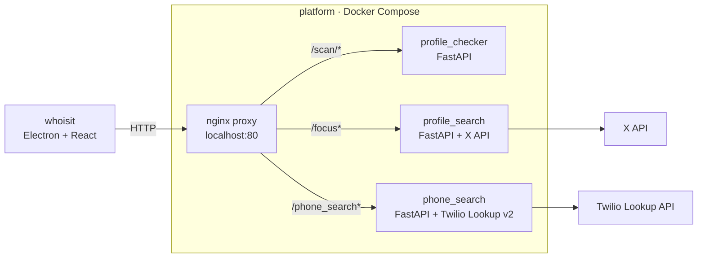

# Open Source Intelligence Platform

The Open Source Intelligence Platform is a modular collection of services for discovering public profiles, inspecting public X profile metadata, and resolving caller information. The [`platform`](https://github.com/osint-services/platform) repository brings the services together behind one nginx endpoint and includes the [`whoisit`](https://github.com/osint-services/whoisit) Electron UI.

## Architecture



The services remain independently runnable, while the platform repository provides:

- Docker Compose orchestration and a shared bridge network
- nginx routing through port `80`
- environment-variable injection for external APIs
- health and readiness endpoints
- helper scripts for starting, stopping, rebuilding, and viewing logs
- an Electron desktop interface for the complete workflow

## Workflow

1. **Scan a username** to discover matching public profile URLs.
2. **Inspect a profile** to retrieve public X account metadata, including identity fields, profile media, verification state, account dates, pinned/recent post IDs, entities, and public metrics.
3. **Look up a phone number** in E.164 format through Twilio Lookup v2 to retrieve validation, formatting, country, and caller-name information when available.

## Repositories

| Repository | Role |
| --- | --- |
| [`platform`](https://github.com/osint-services/platform) | Top-level Docker Compose orchestration, nginx proxy, shared configuration, and service submodules. |
| [`whoisit`](https://github.com/osint-services/whoisit) | Electron and React desktop UI for username scans, profile inspection, phone lookup, and platform status. |
| [`profile_checker`](https://github.com/osint-services/profile_checker) | FastAPI service that validates configured public profile locations for a username. |
| [`profile_search`](https://github.com/osint-services/profile_search) | FastAPI and Tweepy service that retrieves public X profile metadata from a discovered profile URL. |
| [`phone_search`](https://github.com/osint-services/phone_search) | FastAPI service that resolves caller metadata through Twilio Lookup v2. |

## API routes

All routes are exposed through nginx at `http://127.0.0.1:80`.

| Method and route | Service | Purpose |
| --- | --- | --- |
| `GET /scan/{username}` | `profile_checker` | Scan configured platforms for a username. |
| `GET /focus?url={profile_url}` | `profile_search` | Inspect an X profile and return public metadata. |
| `GET /phone_search?phone_number={e164_number}` | `phone_search` | Look up phone and caller metadata. |
| `GET /scan/healthz` | `profile_checker` | Username-scan service liveness. |
| `GET /focus/readyz` | `profile_search` | Profile service readiness, including X credential configuration. |
| `GET /phone_search/healthz` | `phone_search` | Phone service liveness. |

## Configuration

Copy the example file before starting the stack:

```bash
cp .env.example .env
```

Set these values in `.env`:

| Variable | Used by | Meaning |
| --- | --- | --- |
| `TWEEPY_BEARER_TOKEN` | `profile_search` | X API app-only Bearer Token used for read-only public profile lookup. |
| `TWILIO_ACCOUNT_SID` | `phone_search` | Identifier for the Twilio account making Lookup API requests. |
| `TWILIO_AUTH_TOKEN` | `phone_search` | Secret used to authenticate Twilio API requests. |

Never place real credentials in `.env.example`, source files, logs, issues, or commits. The local `.env` file is intentionally ignored by Git.

## Getting started

### Prerequisites

- Git, including configured access to the service submodules
- Docker Engine
- Docker Compose through the `docker compose` command
- Node.js and npm to run the Electron UI
- X API and Twilio credentials for their corresponding features

### Start the platform

```bash
git clone https://github.com/osint-services/platform.git
cd platform
git submodule update --init --recursive
cp .env.example .env
# Add your credentials to .env
docker compose up --build -d
```

Or use the provided helper:

```bash
./scripts/start.sh
```

Verify the routed services:

```bash
curl http://127.0.0.1/scan/healthz
curl http://127.0.0.1/focus/readyz
curl http://127.0.0.1/phone_search/healthz
```

### Start the desktop UI

With the platform stack running:

```bash
cd whoisit
npm install
npm start
```

The UI checks platform availability, can attempt to start the parent Compose stack, and presents the scan, profile, and phone results in one interface.

## Operations

From the `platform` repository:

```bash
./scripts/start.sh    # Build and start the stack
./scripts/stop.sh     # Stop the stack
./scripts/build.sh    # Rebuild service images
./scripts/logs.sh     # Stream service logs
```

## Responsible use

Use the platform only for lawful access to public or properly authorized data. Protect API credentials, respect provider terms and rate limits, and consider the privacy and safety impact of collecting or sharing identifying information.
