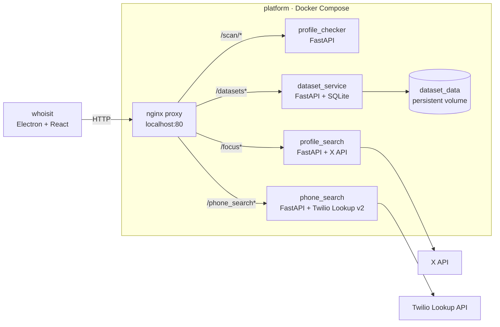

# Open Source Intelligence Platform

The Open Source Intelligence Platform is a modular investigation workspace for discovering public profiles, inspecting public X metadata, resolving caller information, and searching authorized local datasets. The [`platform`](https://github.com/osint-services/platform) repository brings live and imported sources together behind one nginx endpoint and the [`whoisit`](https://github.com/osint-services/whoisit) Electron UI.

## Architecture



The services remain independently runnable, while the platform repository provides:

- Docker Compose orchestration and a shared bridge network
- nginx routing through port `80`
- environment-variable injection for external APIs
- health and readiness endpoints
- persistent normalized profile and phone datasets
- helper scripts for starting, stopping, rebuilding, and viewing logs
- a unified Electron search interface with identifier and source filters, type-specific results, and local history

## Workflow

1. **Enter a username or phone number** in the shared Search workspace. Auto mode routes clearly formatted phone numbers to phone services and other values to profile services; explicit modes handle ambiguous identifiers.
2. **Choose sources** across all connected services, live APIs only, or imported datasets only. Excluded providers are not called.
3. **Inspect a profile** to retrieve public X identity fields, media, verification state, dates, pinned/recent post IDs, entities, and metrics. Public scan evidence remains available when paid X inspection is unavailable.
4. **Review phone results** from Twilio Lookup v2 and exact normalized matches in imported phone datasets.
5. **Import authorized data** from CSV, JSON, JSONL, or NDJSON through one sparse entity pipeline. Each row can contain a profile identifier, a phone identifier, or both; matching either identifier returns the stored association.
6. **Manage integrations** by reviewing the configured and reachable state of X/Tweepy, Twilio Lookup, and local datasets, or replacing provider credentials from the desktop UI.

Live providers and imported sources are queried independently. A provider error is shown with that source while successful results from other sources remain available.

## Repositories

| Repository | Role |
| --- | --- |
| [`platform`](https://github.com/osint-services/platform) | Top-level Docker Compose orchestration, nginx proxy, shared configuration, and service submodules. |
| [`whoisit`](https://github.com/osint-services/whoisit) | Electron and React workspace for combined username and phone search, profile inspection, dataset imports, provenance, and local history. |
| [`profile_checker`](https://github.com/osint-services/profile_checker) | FastAPI service that validates configured public profile locations for a username. |
| [`profile_search`](https://github.com/osint-services/profile_search) | FastAPI and Tweepy service that retrieves public X profile metadata from a discovered profile URL. |
| [`phone_search`](https://github.com/osint-services/phone_search) | FastAPI service that resolves caller metadata through Twilio Lookup v2. |

## API routes

All routes are exposed through nginx at `http://127.0.0.1:80`.

| Method and route | Service | Purpose |
| --- | --- | --- |
| `GET /scan/{username}` | `profile_checker` | Scan configured platforms for a username. |
| `GET /focus?url={profile_url}` | `profile_search` | Inspect an X profile and return public metadata. |
| `GET /phone_search?phone_number={e164_number}` | `phone_search` | Look up phone and caller metadata. |
| `GET /datasets` | `dataset_service` | List imported datasets. |
| `GET /datasets/schema/entity` | `dataset_service` | Describe the unified sparse entity fields. |
| `POST /datasets/import` | `dataset_service` | Import mapped entities with profile identifiers, phone identifiers, or both. |
| `GET /datasets/search/profiles?query=...&fuzzy=true` | `dataset_service` | Search imported profile records. |
| `GET /datasets/search/phones?phone_number=...` | `dataset_service` | Search imported phone records by normalized E.164 number. |
| `DELETE /datasets/{dataset_id}` | `dataset_service` | Delete a dataset and its records. |
| `GET /scan/healthz` | `profile_checker` | Username-scan service liveness. |
| `GET /focus/readyz` | `profile_search` | Profile service readiness, including X credential configuration. |
| `GET /phone_search/healthz` | `phone_search` | Phone service liveness. |
| `GET /datasets/healthz` | `dataset_service` | Dataset service liveness. |

## Configuration

Copy the example file before starting the stack:

```bash
cp .env.example .env
```

Set these values in `.env`:

| Variable | Used by | Meaning |
| --- | --- | --- |
| `TWEEPY_BEARER_TOKEN` | `profile_search` | X API app-only Bearer Token used for read-only public profile lookup. |
| `TWILIO_ACCOUNT_SID` | `phone_search` | Identifier for the Twilio account making Lookup API requests. |
| `TWILIO_AUTH_TOKEN` | `phone_search` | Secret used to authenticate Twilio API requests. |
| `DATASET_DB_PATH` | `dataset_service` | SQLite path; Compose sets `/data/datasets.db` in a persistent named volume. |

Never place real credentials in `.env.example`, source files, logs, issues, or commits. The local `.env` file is intentionally ignored by Git. The desktop Integrations workspace never displays existing values; replacements are handled by the Electron main process, written atomically with owner-only permissions, and applied by recreating only the affected API services when Docker is accessible.

## Getting started

### Prerequisites

- Git, including configured access to the service submodules
- Docker Engine
- Docker Compose through the `docker compose` command
- Node.js and npm to run the Electron UI
- X API and Twilio credentials for their corresponding features

### Start the platform

```bash
git clone https://github.com/osint-services/platform.git
cd platform
git submodule update --init --recursive
cp .env.example .env
# Add your credentials to .env
docker compose up --build -d
```

Or use the provided helper:

```bash
./scripts/start.sh
```

Verify the routed services:

```bash
curl http://127.0.0.1/scan/healthz
curl http://127.0.0.1/focus/readyz
curl http://127.0.0.1/phone_search/healthz
curl http://127.0.0.1/datasets/healthz
```

### Start the desktop UI

With the platform stack running:

```bash
cd whoisit
npm install
npm start
```

The UI checks platform availability, can attempt to start the parent Compose stack, and provides Search, Datasets, Integrations, and History workspaces. Search includes Auto, Profile, and Phone modes plus source filters that control which providers are queried. Datasets use one mapping workflow, require only one searchable identifier per row, and retain typed profile and phone metadata under a shared entity. Imported records preserve their dataset, source, observation time, optional confidence, normalized fields, associations, and original row for audit.

## Operations

From the `platform` repository:

```bash
./scripts/start.sh    # Build and start the stack
./scripts/stop.sh     # Stop the stack
./scripts/build.sh    # Rebuild service images
./scripts/logs.sh     # Stream service logs
```

## Responsible use

Use the platform only for lawful access to public or properly authorized data. Import only data you are permitted to retain and search. Protect API credentials and dataset volumes, respect provider and dataset license terms, apply appropriate retention controls, and consider the privacy and safety impact of collecting or sharing identifying information. The local API currently has no authentication layer and should not be exposed to an untrusted network without access controls.
